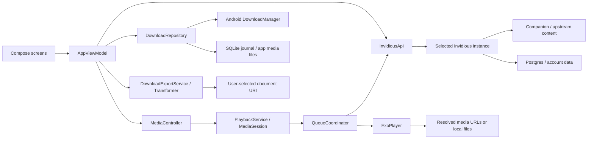

# Architecture

[Documentation index](README.md) · [Source map](reference/SOURCE_MAP.md)

## System boundary

Mobivious displays YouTube content obtained through an Invidious instance. It
contains no YouTube scraper or signature decipherer. Public metadata and media
resolution depend on the instance; account mutations require its authenticated
APIs. Optional features use extensions maintained in the sibling server fork.
Android's download manager and file picker handle local transfers and exports.

## Module and dependency organization

`android/settings.gradle.kts` includes `:app` and the `:macrobenchmark` test module.
The benchmark targets an isolated, profileable app variant. There are no feature modules,
Room database, dependency-injection framework, Retrofit service or Navigation
Compose route graph. `MobiviousApplication` constructs process-wide dependencies;
the activity creates an `AndroidViewModel`, which drives Compose with StateFlows.

| Area | Ownership and responsibility |
| --- | --- |
| `MobiviousApplication.kt` | Constructs SessionStore, API, feed cache, downloads, watched/blocked repositories, DeArrow and AI lookups. Publishes playback queue/context and cached-results status. |
| `MainActivity.kt` | Edge-to-edge host, incoming VIEW/SEND links, new intents, lifecycle settings refresh, fullscreen system bars and PiP parameters/actions. |
| `data/` | Domain models, JSON parsing, HTTP, preferences, local profile storage, visibility rules and stateful browsing controllers. |
| `ui/AppViewModel.kt` | Navigation/browse snapshots, loading/pagination, account actions, settings writes, controller connection and presentation-facing state. |
| `ui/MobiviousApp.kt` | Compose shell, screen/panel selection, watch presentation, navigation controls, dialogs and callbacks. |
| `player/PlaybackService.kt` | Owns decoder, media session, history/progress writes, SponsorBlock engine and service lifetime. |
| `player/QueueCoordinator.kt` | Resolves current media, fetches source pages, owns occurrence identity, tracks, link bounds, clips, offline loading and successor rules. |
| `player/PlaybackQueue.kt` | Queue runtime snapshot, occurrence identity, repeat and successor/merge rules. API source/page models stay in `data/Models.kt`; data does not depend on the player. |
| `downloads/DownloadExportService.kt` | User-started foreground copy, muxing or explicitly approved conversion to a document URI. |
| `data/DownloadReceiver.kt` | Manifest-bound DownloadManager broadcast adapter. Its existing component identity is preserved; repository persistence does not depend on the activity/application wiring. |

Versions and prerequisites are recorded in [Development](DEVELOPMENT.md). The
main libraries are Compose Material3, Media3 ExoPlayer/session/UI/Transformer,
OkHttp, Coil, coroutines, WindowManager and RE2/J. JUnit, MockWebServer and Android
Compose tests supply validation. All dependency versions are pinned in Gradle.

## Startup and lifetime

1. Application startup reads and migrates SessionStore profiles, initializes
   downloads from SQLite, restores interrupted export status and builds repositories.
2. `MainActivity` enables edge-to-edge rendering and composes `MobiviousApp`.
   The view model asynchronously connects a MediaController to PlaybackService.
3. The service creates ExoPlayer, QueueCoordinator and QueueSessionPlayer, then
   exposes a MediaSession. The controller reconnects to service state after activity
   recreation; it does not create a second decoder.
4. Initial guest defaults come from the local instance profile. Signed-in shared
   preferences are fetched from the server. Browse content loads independently.
5. Incoming links are consumed once by the view model/activity pair. New intents
   use `onNewIntent`; recreating an existing activity must not replay its launch link.
6. `onStart` refreshes shared settings. Leaving the activity enters permitted PiP
   or preserves background playback; disabling background playback pauses on stop
   outside PiP. [Playback](PLAYBACK.md) describes the service lifecycle in detail.

View-model/controller objects survive configuration recreation. Some Compose
presentation and draft values use `rememberSaveable`. Feed positions, loaded
comments and logical queue state are predominantly session/process state, not
a durable process-death navigation or queue journal. Downloads and explicitly
saved preferences/progress are durable.

## State model

| State | Contents |
| --- | --- |
| `BrowseState` | Raw videos, search results, playlists, clips, posts/channels, pagination, loading/error/retry state and scroll position. |
| `PlaybackQueueSnapshot` | Session token/context, occurrences, current key, source metadata, details, source errors, repeat, selection and carried link options. |
| `PlaybackState` | Controller-derived position/duration/buffering, available commands, tracks, selection, decoded geometry and current clip/download. |
| `AccountPreferences` | Supported website-compatible preferences plus chat, SponsorBlock and AI settings. |
| `CommentsState` | Target/context, sort, main feed, independent reply feeds and positions. Video and post controllers are separate. |
| `ChatReplayState` | Video/occurrence, availability, presentation visibility, messages/window, following and timing synchronization. |
| Repository state | Confirmed watched/progress, blocked channels, subscription membership/statistics, downloads and optional title/classification lookups. |

Compose observes StateFlows through `collectAsStateWithLifecycle`. Controller
events and a 500 ms UI tick update playback. The service performs periodic work
even when no activity is attached. UI state is separate from playback intent:
`isPlaying`, `playWhenReady` and loading/buffering have different meanings.

## Context and concurrency invariants

`ApiContext(server, account, generation)` identifies the exact live session.
Changing account/token/profile/server advances `SessionStore.contextGeneration`.
Requests capture context before work and check it before accepting results. Old
responses cannot populate a new account's screens or claim a new playback owner.

Context checks are supplemented by narrower revisions: browse generations,
preference generations, queue tokens, occurrence keys, comment sort revisions,
subscription mutation revisions and watched/blocked write tickets. These prevent
an older read from undoing a newer action within the same account. Writes use
mutexes where ordering matters; repeated taps are disabled while mutations run.

API work runs on IO with cancellable OkHttp calls. Playback and Transformer calls
run on their owning main scopes. Application lookup scopes use `SupervisorJob`;
optional lookup failures do not cancel playback. Account/instance transitions
reset screen state and close the old queue. Persistent profile identity is separate
from request generation and bearer token identity; see [Storage](STORAGE_AND_SECURITY.md).

## Browsing and navigation

Internal tabs are `Popular`, `Trending`, `Subscriptions`, `You`, with `Search`
as a transient destination. The shell presents four labeled destinations in a
bottom bar or rail, with Search in the top app bar. Route strings include
`channel:<id>`, `playlist:<id>`, `post:<id>`, `hashtag:<tag>`, `subscription-channels`,
`playlists`, `history`, `clips`, `downloads` and `sign-in`. Settings pages are
selected by UI page names, not by a persistent route graph.

`BrowseReturn` captures the tab, route, raw page state, selected channel tab/sort,
search draft/submission, playlist segment, preferences and position. Independent
tab snapshots and return stacks preserve the user's origin after search, details
or sign-in. Changed browsing preferences invalidate affected snapshots. Account
and instance changes clear account-sensitive navigation state.

Channel tabs retain their loaded pages, sort and position in a bounded set of
24 session snapshots. A first visit inherits the current channel sort; subsequent
visits restore that tab's own choice. Scoped-search returns keep the unfiltered
origin, and account/instance generation changes clear these snapshots.

Pagination operates on raw source rows, before membership/block/AI filtering.
Video merge identity includes `(videoId, indexId, playlistIndex)` so playlist
duplicates survive. Mixed search tracks source keys, including unsupported rows,
to detect repeated pages. Failed load-more requests preserve existing rows and
retry their cursor. Channel continuations remain opaque; repeating continuations
stop pagination. See [API](API.md) for each endpoint's pagination scheme.

## Failure and offline model

Browse, source-queue, decoder, save, reply and optional-tool errors have independent
state. HTTP errors become actionable `ApiException` messages. Coroutine
cancellation remains cancellation, rather than becoming a connection error.
Cached results are available for selected GET endpoints on eligible failures;
they are not a mutation queue or a guarantee of offline streaming. Explicit
downloads provide offline media. [Troubleshooting](TROUBLESHOOTING.md) describes
recovery and the distinction between server, token, device and decoder failures.

## Opaque UI and automatic preference intents

`AppTheme` owns fixed neutral roles and six device accent presets. Native Material
components replace all optical rendering; `WatchAmbient` alone samples bounded
video colors when explicitly enabled. `AppScaffold` defines four roots and rail
breakpoints; `AppWindowLayout` selects a contiguous pane around an occluding hinge.

`PreferenceSaveController` lives in `AppViewModel`. It retains confirmed/requested
values, per-key revisions and pending/invalid/error states across navigation and
recreation. A single worker coalesces unsent same-key edits; the sink uses the
shared preference mutex and sparse patches against current confirmed data. Text
has a 500ms debounce with lifecycle flush. Account/server generation changes
invalidate queued work. Entity/security operations keep explicit submit semantics.
See [UI](UI.md), [Settings](SETTINGS.md) and [Testing](TESTING.md).
