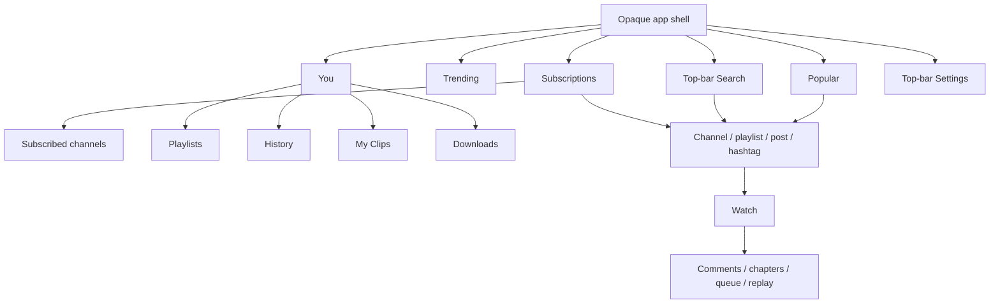

# Screens and interaction flows

[Overhaul entry point](README.md) · [Design system](DESIGN_SYSTEM.md) ·
[Save implementation](IMPLEMENTATION.md#automatic-preference-saving)

**Proposed layouts and behavior.** Wireframes below are structural diagrams,
not screenshots or measured rendering evidence. IDs match the
[baseline inventory](BASELINE.md#screen-and-state-inventory).

## Shared state and navigation rules

Every screen uses these rules unless its entry gives a more specific treatment:

| State | Required treatment |
| --- | --- |
| Initial loading | Keep title/navigation/actions that remain valid; show a bounded progress indicator and text in the body. No empty-result claim before the response. |
| Refresh | Keep existing usable data and position; show refresh progress. A failed refresh adds inline Retry without erasing rows. |
| Load more | Footer progress/error with retry of the same cursor; preserve existing rows, order and position. No full-page spinner. |
| Empty | Explain what is empty and give the relevant action (Search, Subscribe, Create or Download guidance). Filtered emptiness offers Clear filters. |
| Failure | Explain the failed operation; show Retry or the actual next step, including sign-in/unsupported-server guidance. Do not remove unrelated usable content. |
| Offline | Show cached content when available with a status label; no cache means a connection explanation and Retry. Local downloads/settings remain usable. Do not imply streamed pages are a guaranteed offline cache. |
| Signed out | Public pages remain available. Account-owned pages show an inline sign-in explanation with the destination preserved for return. Downloads and local guest settings remain directly accessible. |
| Mutating action | One pending action per target, duplicate activation blocked, success reflected after confirmation; failed actions retain confirmed data and provide Retry. |

Network states do not apply to purely local preference reads, text filtering or
local media playback. Their meaningful failures are persistence, missing files or
decoder errors. Forms use submitting/validation/failure states rather than
refresh/pagination. Unsupported optional capabilities have explanatory unavailable
states; never manufacture an empty list or advertise an action the server cannot
perform.

### Navigation hierarchy and Back



- Root order is Popular, Trending, Subscriptions, You. They have independent
  navigation stacks, loaded state, filters and scroll positions within the
  current context. Switching tabs restores that tab; it does not refresh it.
- Tapping the selected tab on a child page returns to its root at the retained
  root position. Tapping it at the root scrolls to top without a network refresh.
  Pull to refresh is separate and has an accessible Refresh action.
- Search is transient, not a fifth tab. Preserve originating tab/route/position,
  watch presentation, submitted query and scoped-search context. Selecting
  another tab explicitly leaves search and restores that tab.
- Use Back precedence: dismiss the IME first; then topmost menu/dialog/sheet;
  then a reply thread/inner tool page; then the active watch tool; then fullscreen
  to watch; then watch to mini; then a nested browse/search/settings route to its
  origin. A root browse destination with no transient state delegates Back to
  Android; do not loop through previously selected root tabs.
- Modal entity editors with edits offer Discard/Keep editing on dismissal.
  Preference pages have no page-level draft or discard prompt; use the automatic
  save protocol. Successful explicit submissions return to the invoking context.
- Preserve current launch-home values, including Search and account-only library
  choices. Popular remains the default; signed-out account-only values fall back
  using existing preference rules. Homepage does not change tab order.
- Internal content links retain the invoking context. External/unsupported or
  foreign-instance content keeps the existing explicit browser action.
- Account/instance changes cancel obsolete navigation intents and sensitive
  responses. Never show another account's retained page or draft. Sign-in resumes
  the specific authorized intent once; canceling it clears that intent.

### N1: Main shell

```text
┌─────────────────────────────────────────┐
│ Popular                    Search  Gear │  solid top app bar
├─────────────────────────────────────────┤
│                                         │
│ Scrollable destination content          │
│                                         │
├─────────────────────────────────────────┤
│ Preview  Title / creator    Play  Close  │  only with active mini playback
├─────────────────────────────────────────┤
│ Popular  Trending  Subscriptions  You    │  four labeled destinations
└─────────────────────────────────────────┘
```

Search and Settings are always available from root browse app bars, including
guests. Details add Back and retain Search plus a contextual overflow; Settings
is available again at the root. Titles describe the actual destination, not a
decorative oversized app name. You shows identity in its content. Navigation is
opaque, stationary and outside the scrollable content.

Use the rail, size bounds and measured inset policy from DESIGN_SYSTEM at wider
widths. Global errors are snackbars only for brief action feedback; persistent
connection, blocking or save failures belong beside affected content.

**Accept:** all four tabs have full semantic labels; no Discover segment or Search
circle remains; root/tab restore, window resize and system bars leave no clipped
content or overlapping controls.

### N2: Mini-player

Place a solid full-width row immediately above bottom navigation, or at the
bottom of the wide content region beside the rail. Order: live preview, title and
creator, Play/Pause/Replay, Close. Put a thin progress line at the row's top.
The title/preview restores watch. Close stops/closes the existing player session.
Keep horizontal dismiss and upward restore gestures with visible/TalkBack
equivalents and existing gesture arbitration.

Loading/buffering is local to the preview/control area; errors have a labeled
Retry action and do not replace navigation. Disable unavailable transport actions.
Audio-only uses a media placeholder without requesting a decoder preview.
Hide mini presentation during IME input and modal full-screen editors; playback
continues under existing policy. No mini-player in expanded watch/fullscreen/PiP.

**Accept:** independent ≥48dp transport/close targets; no row tap after a claimed
drag; one decoder survives restore/minimize; browsing can reach its last item.

### N3: Global and scoped search

```text
┌─────────────────────────────────────────┐
│ Back  Search or paste a link…   Clear Go │
├─────────────────────────────────────────┤
│ All  Videos  Channels  Playlists & mixes │
│ Filters: Relevance · Any date · Any time │
├─────────────────────────────────────────┤
│ Mixed result rows                       │
│ Footer: loading / retry                  │
├─────────────────────────────────────────┤
│ Mini-player when keyboard is closed     │
│ Popular  Trending  Subscriptions  You    │
└─────────────────────────────────────────┘
```

Opening Search focuses the top field. Typing only edits the query; keyboard
Search, physical Enter or Go submits once. Blank submission is ignored. Clear
clears the input without silently navigating or issuing an empty request. Preserve
supported URL parsing, links and existing search-history affordances; history
can be removed/cleared with the existing semantics.

All/Videos/Channels/Playlists & mixes retain supported sort/date/duration filters,
members override and include-blocked behavior. Show active filter summaries; an
opaque filter sheet applies each valid selection immediately to the search state.
No preference Save footer. Filter changes retain the query, reset pagination and
announce result updates without stealing focus.

Channel, subscription and history searches label their scope visibly. Back first
leaves results/details, then restores the initiating scope and position. Do not
turn a local directory filter into a server query. Empty results distinguish
no query, no matches and all-hidden results; pagination still follows raw pages.
Public search works signed out; connectivity/compatibility states follow the
shared rules.

**Accept:** every submission method produces one action; result order and mixed
types survive; keyboard clears shell space; Back restores origin after a result.

## Browsing and community

### B1–B2: Popular and Trending

```text
┌─────────────────────────────────────────┐
│ Trending                   Search  Gear │
├─────────────────────────────────────────┤
│ Livestreams  Gaming      Region: US ▼    │  Trending only
├─────────────────────────────────────────┤
│ ┌─────────────────────────────────────┐ │
│ │             Thumbnail               │ │
│ └─────────────────────────────────────┘ │
│ Avatar  Video title                  ⋮ │
│         Creator · views · date         │
│                                         │
│ Next item…                             │
└─────────────────────────────────────────┘
```

Popular is a direct feed of the instance's Popular content; it is not a
personalized recommendation home. Trending has Livestreams/Gaming controls and a
searchable country picker, retaining country-name/code localization and current
server behavior. Country selection saves automatically with pending/error state;
failed persistence retains the confirmed region. Category selection is profile-local.

Use Comfortable/Compact/text-only item variants, watched/progress indicators,
DeArrow titles and optional AI replacements consistently. Video opens watch;
creator opens channel; overflow retains existing Save/queue/block/share actions.
Blocking uses current confirmation/Undo behavior. Refresh keeps position until
new content is ready; load-more errors remain footer-local. Guests browse freely.

**Accept:** both feeds independently retain position/category; no optical work
runs during scrolling; filtering does not prevent loading subsequent raw pages.

### B3: Subscriptions feed

Hierarchy: app bar → creator shortcuts → Channels and scoped Search actions →
uploads. Put RSS/OPML in the app-bar overflow. Feed filters are labeled chips or
the Subscriptions settings page, not unlabeled icon toggles. Keep sorting,
latest-per-channel, unwatched and pending-notification filters with their current
meaning; notification filtering does not promise Android alerts.

Signed out: explain subscriptions and offer Sign in; no fake empty feed.
Signed in with no subscriptions: offer Search for channels. All-hidden/filtered
uploads offer filter adjustment. Refresh, pagination and offline use shared states.
Subscribe actions preserve confirmed membership during pending/failure.

**Accept:** uploads, directory, scoped search and exports remain reachable;
sign-in resumes the feed/subscribe intent without losing the originating page.

### B4: Subscribed Channels directory

Hierarchy: Back/title → local name-filter field → labeled sort choice →
continuous creator rows. Row: avatar, name, available upload/viewing metadata,
explicit subscribed state/overflow. Select opens the channel. Sort options retain
Relevance/Latest/Most watched/A–Z, saved profile-locally. When statistics are
unavailable, explain A–Z fallback without overwriting the chosen sort.

No network request per filter keystroke. Distinguish no subscriptions from no
local matches. Initial fetch/refresh errors and offline rows follow shared rules;
account permission failures offer sign-in or the documented compatibility step.

**Accept:** one centered column, no metadata invented for missing statistics,
long names wrap, sorting/filtering retain stable identity and accessible actions.

### B5: Channel and scoped results

Hierarchy: app bar → real banner/avatar → identity and Subscribe/Subscribed →
description link → advertised tabs → sort/scoped search → content. Identity may
include verified state, subscribers, handle/pronouns and inventory only when
provided. Header background and controls remain opaque; no stretched banner wash.

Retain Videos, Shorts, Streams, Podcasts, Releases, Courses, Playlists, Clips,
Posts and Channels when advertised; normalize aliases and preserve the Videos
fallback and auto-generated-channel restrictions. Tabs scroll horizontally and
keep semantic selected state. Preserve tab-specific sort and per-tab position.
Scoped search returns to the same channel/tab/sort.

Use type-appropriate video/playlist/creator/clip/post rows. Unsupported or absent
tabs stay hidden. Empty tabs, failed continuations and unavailable metadata are
localized to the relevant region. Channel access is public; protected actions
prompt for authentication, not the entire channel.

**Accept:** no advertised capability disappears; header long text, missing
banner/avatar, per-tab pagination and Subscribe failure remain usable.

### B6: Channel description and rich information

Open an opaque full-height sheet with title, Close and scrollable native rich
text/links/available statistics. Keep full text readable at large sizes and retain
native content-link resolution. No optional field creates a blank labeled row.
An unavailable/empty description gives a short explanation; link failures are
local and Close remains usable offline/signed out.

**Accept:** focus returns to Description; internal links preserve the channel
origin; no web scripting or additional creator lookup is introduced.

### B7: Community feed, post detail, comments and gallery

Feed posts use creator/date → expandable text → attachment → comment/share
actions. Detail shows full text and attachments with Back. Keep single/multiple
images, video/playlist attachments, read-only polls/quizzes, unknown-attachment
fallbacks and native links. Comments/replies use the common discussion rows and
independent post-comment controller.

Image gallery is a full-screen neutral viewer with Close, position count and
Previous/Next. A failed image retains navigation and Retry. Missing attachments
are explained within the post. Public read-only access remains available signed
out; server/network/page states follow shared rules. Do not add voting, posting
or moderation controls.

**Accept:** feed expansion keeps position, post/comment navigation preserves
channel context, failed gallery assets never strand the user.

### B8: Hashtag and other linked browse results

Use Back + hashtag/title, followed by the shared result feed and its applicable
filters/pagination. Preserve the source order and content-link origin. Shared
loading/empty/error/offline states apply; public results need no account.

**Accept:** native hashtag links and external fallback retain current resolution
rules and do not create a separate visual language.

## You and library

### L1: You

```text
┌─────────────────────────────────────────┐
│ You                        Search  Gear │
├─────────────────────────────────────────┤
│ Avatar  Account name / Guest            │
│         Current instance                │
│ Sign in  (guests)                        │
├─────────────────────────────────────────┤
│ Your library                            │
│ Playlists                            >  │
│ History                              >  │
│ My Clips                             >  │
│ Downloads                            >  │
└─────────────────────────────────────────┘
```

Use continuous labeled launch rows rather than four floating cards. Account
management is in Settings → Account; instance identity links to Server settings.
All launch rows remain visible to guests; only account-backed pages require
sign-in. Downloads opens immediately and remains available offline.

Identity fetch failure does not remove local destinations. Empty library content
is explained on its destination rather than replacing this navigation hub.

**Accept:** every library destination is one tap from You; long identity text and
signed-out/offline states retain working Downloads and Settings access.

### L2–L3: Playlists, mixes and save/edit panels

Playlists: app bar → My playlists/Subscribed segments → list; Create playlist is
a labeled primary action. Detail: artwork/title/privacy/description disclosure →
Play/Listen/queue actions → occurrence rows. Preserve saved external playlist/mix
references, ownership-only editing, unavailable-entry handling and duplicates.

Save video opens an opaque sheet with owned playlists, default playlist first,
labeled Save here actions and Create playlist. Selecting a playlist explicitly
adds the video through the existing save action; show pending/error per target.
Do not turn this into a membership toggle or implicitly remove occurrences.
Creation/editing uses explicit Create/Save with title, privacy and description
fields. Delete confirms the named playlist; removing one occurrence is distinct
from queue removal.

Signed out: offer sign-in for owned/saved collections and saves; public playlist
details remain readable. Empty My playlists offers Create; empty Subscribed
explains saving external lists. Refresh/offline/load-more follow shared rules.

**Accept:** duplicates remain independent, external lists do not become editable
copies, create-return-to-save and failure retry preserve the pending video.

### L4: History

Hierarchy: Back/title → scoped search → existing calendar groups → video rows.
Individual Remove is a row overflow action; Clear history is in page overflow
with confirmation describing that it clears history and saved resume positions.
Preserve the different individual-removal behavior, exact date formatting and
older-server flat-history fallback with unavailable organized search explained.

Signed-out guests receive a sign-in explanation for shared history while their
local resume policy remains intact. Empty/filtered/load-more/offline states follow
shared rules. Do not show Clear as enabled when there is nothing to clear.

**Accept:** groups/search/positions survive return; removal, clear and Undo where
currently supported retain their actual data semantics.

### L5–L6: Downloads, selection and export

Downloads: Back/title → local entries ordered by existing repository rules.
Each entry shows artwork/title, format/size/progress/status, Play when ready and
available Cancel/Retry/Save to files/Delete actions. Keep entry details in an
opaque sheet. Missing/corrupt files get explicit local recovery, not endless
network retry. Empty state explains the watch Download action.

Track selection uses labeled Video/Audio/Captions groups, available-track details,
validation and explicit Download. Preserve video-only/audio-only/paired choices
and caption-only invalidity. Restricted/upcoming/live media explain unavailability.
Repeated Download creates a new entry; Retry repairs the original.

Export opens Android's destination picker. Single assets copy unchanged; paired
assets attempt merge, then explicitly offer Convert and export when necessary.
Show operation progress/cancel/error and preserve capability checks. Delete names
the entry and its app-specific files; exported copies are independent.

Everything already saved remains accessible to guests and after sign-out/server
changes. Offline does not disable local playback/export. Starting a network
transfer offline gives a clear retryable failure without losing track choices.

**Accept:** background/restart persistence, separate resume positions, duplicate
entries, incomplete-asset retry, file picker cancellation and conversion consent
remain intact.

### L7–L8: Clips and creation

My Clips/channel Clips: shared clip rows with title, creator, duration and existing
date metadata. Detail/playback shows clip-relative position/loop, Share/Copy,
Continue full video and ownership-only Delete. Foreign-instance clips keep the
browser action. Public channel clips work without sign-in; My Clips requires it.
Use the shared fetch/empty/offline/error states.

Create clip is Watch → More → Create clip. Present an opaque full-screen editor:
title → independent preview → filmstrip/handles → start/end tenth-second fields →
duration/help → Publish and Cancel. Preserve 1–140 Unicode-code-point title and
5–120 second in-video range rules. No clipping of active livestreams or editing
published clips. Validation stays beside the field/range; failed publishing
retains edits and Retry. Closing edited content asks to discard.

**Accept:** main playback ownership is preserved, preview disposes safely, IME
cannot cover title/error/Publish, precise fields and handles stay synchronized,
authentication returns to the requested creation intent.

### L9: RSS and exports

Use a shared opaque sheet with labeled public/private links, Copy/Share and
Save/export actions. Channel/public-playlist/mix RSS, private subscription feed,
RSS/NewPipe OPML and owned playlist Atom retain their current availability.
Identify private links as carrying account access; do not expose tokens in logs
or screenshots. Account-only choices offer sign-in; no local reader is added.

Show generation/export progress, cancellation and retry locally. Keep already
generated public link actions usable offline where possible; token-dependent
generation explains connection requirements.

**Accept:** Android sharing/document picker flows, format choice and access
labels remain clear; cancellation returns to the invoking feed/library page.

## Settings, account and optional tools

### S1: Settings root

```text
┌─────────────────────────────────────────┐
│ Back  Settings                          │
├─────────────────────────────────────────┤
│ Account                                 │
│   Account                            >  │
│ Preferences                             │
│   Appearance                         >  │
│   Playback                           >  │
│   Browsing                           >  │
│   Subscriptions                      >  │
│   History & library                  >  │
│ Community tools                         │
│   SponsorBlock / DeArrow / AI filter  >  │
│ Connection & app                        │
│   Server / About                     >  │
└─────────────────────────────────────────┘
```

Shared group surfaces, simple section headings and continuous rows. Account
identity and scope summaries explain where data is saved without technical
implementation language. Keep Settings available to guests.

**Accept:** all existing categories remain discoverable; navigation returns to the
prior browse/watch context; no hidden Apply/Save footer remains for preferences.

### Preference-page contract: S2–S6, S8–S10, W6 settings

Choices and toggles save immediately; valid text/numeric preference edits autosave
after 500ms quiet or on Done/focus loss. Sliders commit on drag release. Show
Saving only while pending, and an inline failure with Retry and the affected
value; successful ordinary changes do not emit a snackbar each time.
See [the save protocol](IMPLEMENTATION.md#automatic-preference-saving) for
ordering, validation, failure and context-change handling.

Local preference pages have no fetch spinner just to show stored values. Shared
pages can refresh account values without replacing focused/pending edits.
Unchanged unsupported imported values remain readable; editing another field
must not normalize away unrelated website choices. Offline local settings save;
shared saves show failure/retry, never a false Saved state.

| ID / screen | Hierarchy and actions | Special states and acceptance |
| --- | --- | --- |
| S2 Appearance | Color mode; Accent picker; List density; Hide thumbnails; Ambient mode; Reduce transparency. Each row shows current choice. | Remove Colored backgrounds/Adaptive control colors. Scope labels distinguish shared Color mode/density from device accent/ambient. Theme changes preserve menus/focus/edits. |
| S3 Playback defaults | Group start/continuation/loop; audio/proxy; speed/quality/codec; caption priorities; background/PiP. | Preserve every current preference/range and next-video versus current-occurrence meaning. Unsupported device/server choices explain unavailability. Caption priorities commit as one valid tuple. |
| S4 Browsing / Blocked channels | Homepage, region, related videos, initial description, comments, members visibility; Blocked channels link to searchable rows/unblock. | Guest homepage choices remain limited; blocking failure retains confirmed membership; unblock/clear actions follow current confirmation rules. |
| S5 Subscriptions preferences | Videos per page; sorting; latest/unwatched/pending-only choices. | Account-only fields show sign-in explanation. Validate 1–1500; no Android notification promise. |
| S6 History & library | Watch history, remember position, default playlist. | Guest watch-history normalization remains; selecting no default is explicit. Disabling resume retains existing clear-position side effect after successful save. |
| S8 SponsorBlock | Enable; category mode/color rows; channel overrides and reset to inherit. | Preserve Auto/Manual/Marker/Disabled and category hues. Color fields retain existing valid custom category colors, independently of accent presets. Sparse-map edits must not erase other overrides; missing service does not block playback. |
| S9 DeArrow | Enable; original-title display; identity status with explicit Import/Clear; separate contribution editor from Watch More. | Identity operations remain explicit, validated and sensitive. Title/vote submissions retain review and explicit Submit; unavailable title lookup retains original titles. |
| S10 AI filter | Master toggle; Blocklist/Warnlist actions by surface; status/Refresh; collapsible details and attribution. | Preserve Hide/Replace/off constraints and library/download exceptions. Loading/stale/unavailable lists never mean unresolved creators match; preference failures show local Retry. |

Reduce transparency remains an accessibility choice that suppresses optional
ambient lighting; it does not switch the already opaque UI to another renderer.

### S7: Server and About

Server is an explicit connection operation, not an autosaving preference field.
Show current origin, editable HTTPS origin, inline validation and Connect.
Changing server warns that it signs out and closes current playback, then uses
the existing context switch. Cancel keeps the origin. Downloads remain local.
Validation or persistence failure retains the input and confirmed origin; do not
autoswitch on typing or focus loss. After a successful origin switch, subsequent
network failure shows Retry on the new instance; Connect does not promise a
transactional server-reachability check.

About shows build, Invidious/Companion and community-data attribution/licenses
and existing links. Remove Backdrop attribution only when its dependency/code
and any remaining attribution obligation have actually been removed. About is
readable offline; a failed external link has a local explanation.

**Accept:** guest/account/profile boundaries and origin validation remain;
Connect cannot save partial input; no release updater is introduced.

### A1: Authentication

Sign-in/register/challenge pages use Back/title → instance/account explanation →
labeled autofill-compatible fields → explicit Sign in/Create account/Continue →
inline status/error and supported alternate flows. Preserve password-manager
semantics, secure masking, CAPTCHA/challenge display and registration restrictions.
Do not autosubmit credentials.

Submitting disables duplicate actions while keeping errors and cancel/back policy
clear. Offline/auth/server failures preserve non-secret corrections where safe;
challenge assets can retry. Success resumes the authorized destination/action;
canceling clears it. Never expose password/token contents in evidence.

**Accept:** keyboard/large text cannot hide the active field or submit action;
context changes drop old-account credentials and ignore late responses.

### A2–A3: Account, credentials, sessions and API tokens

Account root shows identity and Change username, Change password, Sessions & API
tokens, Sign out and Delete account. Credential forms have explicit submit and
validation. Session rows show known metadata, current-session badge and Revoke;
confirm revocation/deletion with the target and consequences. Token creation
shows supported scope/expiry fields and explicit Create; sensitive token display
uses the existing copy/protection behavior.

Signed out: Sign in instead of blank management rows. Fetch/refresh/offline
failures leave identity/local destinations usable but never claim revocation or
credential changes succeeded. Current-session revocation and deletion keep the
existing sign-out/profile cleanup behavior.

**Accept:** all management operations remain reachable, only confirmed server
results change identity/session state, and sensitive values do not survive a
context switch.

## Watch and playback

### W1: Watch page and information

```text
┌─────────────────────────────────────────┐
│ Collapse                     Player menu│
├─────────────────────────────────────────┤
│ Fitted video with standard controls     │
├─────────────────────────────────────────┤
│ Video title                             │
│ Creator                 Subscribe       │
│ Save  Download  Share  More              │
│ Description / metadata               ▼  │
│ Comments   Chapters   Queue   Chat*     │
│ Related videos                          │
└─────────────────────────────────────────┘
* Chat appears only when replay is available.
```

Full watch hides global navigation and mini-player. Use opaque neutral metadata,
actions and tool surfaces. Fit decoded geometry and preserve portrait
scroll-driven height reduction, compact discussion height and wide supporting
pane policy. A player transition keeps the same decoder and queue occurrence.

Title wraps; creator opens channel; Subscribe retains pending/failure semantics.
Save/Download/Share/More retain labels; More includes eligible Create clip and
DeArrow contributions. Description expands inline with rich links, exact/qualified
statistics, dates, availability and music credits only when supplied.
Recommendations retain visibility/AI rules and optional disabling.

Metadata loading/error does not unnecessarily interrupt playable media. Playback
failure has transport-local Retry; missing recommendations are not a playback
error. Public watch works signed out; protected actions resume after sign-in.
Offline downloads use the same layout and local media capabilities.

**Accept:** all actions remain reachable at narrow/large text; descriptions,
creator links and recommendations preserve navigation and player ownership.

### W2: Transport, settings, fullscreen and PiP

Keep Play/Pause/Replay, previous/next, timeline, time/chapter, seek feedback,
fullscreen, settings and chat where supported. Give each its own ≥48dp target.
Use local video scrims from DESIGN_SYSTEM; no backdrop sampling or glass
control plates. Retain double-tap accumulation, seek/chapter/SponsorBlock markers,
buffering/error/Retry and accessible seeking.

Player settings is an opaque sheet: Quality, Audio, Captions, Speed, Audio only,
Ambient mode, PiP and Refresh buffer, with existing supported choices and
occurrence/default precedence. Selection is immediate, returns to its parent
menu where appropriate and reflects confirmed availability. No shared-preference
Save footer. Unsupported tracks are explained/disabled; no fabricated tracks.

Fullscreen retains fitted black letterboxing, caption positioning, native
top-edge system gesture and orientation policy. Back returns to watch without a
reload. PiP keeps system controls and existing eligibility/background rules.
Audio-only retains transport/queue with no decorative video work.

**Accept:** no decoder recreation from theme/menu/presentation changes, no lost
track choice, accidental seek or duplicated action, no glass popup in any mode.

### W3: Queue

Open from a labeled watch action into an opaque full-height sheet on phones or
the supporting pane on wide watch. Show current occurrence, ordered items,
available Play next/Add/Remove controls, previous/next and repeat state using
existing capabilities. Do not add reordering, shuffle or process-death recovery.

Each occurrence has stable identity; repeated video IDs remain separate.
Current occurrence is marked by text/icon/state, not only color. Empty queue and
unavailable entries have an explanation; local order operations do not need a
network spinner. Fetch-dependent actions use local pending/retry.

**Accept:** removing one occurrence cannot remove all matching videos or a saved
playlist entry; close/back returns to unchanged playback.

### W4: Comments and replies

Phone watch replaces the details area below the compact picture with a titled
panel; wide watch uses the supporting pane. Show Top/Newest, read-only rich
comment rows, More/retry, reply counts and a Close action. Reply threads have
Back to comments and independent retained position.

Load on demand; no request just because the entry is visible. Empty, disabled,
unavailable and failed comments have distinct text. Opening comments closes
incompatible tools. Public comments work signed out; no posting/like controls.

**Accept:** reply Back precedes panel close, ordering/positions persist, metadata
badges/links/emoji remain readable and the video stays usable.

### W5: Chapters

Use the same titled tool panel with current chapter, timestamped rows and Close.
Selecting a chapter seeks in the existing occurrence and marks current position.
Unavailable/unknown/non-seekable cases explain why there are no usable chapters.
Keep manual-description parsing and minimum-valid-chapter rules.

**Accept:** no extra queue entry or media reload from seeking; current chapter
and transport semantics match; no promise of upstream automatic chapters/previews.

### W6: Archived chat replay, settings and adjustment

Expose Chat only with replay availability. Docked chat replaces the phone detail
area or uses the wide supporting pane; overlay mode uses saved bounded geometry
over video. Header: title, mode/settings menu, Close. Messages retain rich badges,
timestamps, Earlier messages and Follow playback behavior.

Loading/empty/replay-end/error states stay inside the panel. Seeks and following
playback use the current controller behavior. Mini/PiP/background or hidden panels
suspend fetching; reopening catches up instead of restoring a stale fetch loop.

Settings groups: timestamps, user filter, word/RE2 filter, per-video delay;
appearance/mode/font/opacity; layout fractions. Preferences autosave by the common
protocol with existing size/range/regex validation and separate API scopes.
Unsupported unchanged imported regex remains reported and skipped; invalid new
input does not replace confirmed filters.

Adjust overlay remains an explicit editor with handles and accessible move/resize
actions, Done and Cancel. Done saves the geometry tuple; Cancel discards the
adjustment. This transaction is distinct from preference autosaving.

**Accept:** read-only replay, mutual exclusion with other tools, fetch
suspension, per-video delay direction, draft geometry cancellation and player
control priority remain intact.

## Cross-screen acceptance

For every entry above, verify applicable states from the shared matrix, light and
dark, narrow and wide, large text and accessibility. The
[verification guide](VERIFICATION.md) maps existing suites and specifies evidence.
An implementation package is not complete while a secondary menu/editor in its
screen family still uses glass or an obsolete preference Save footer.
